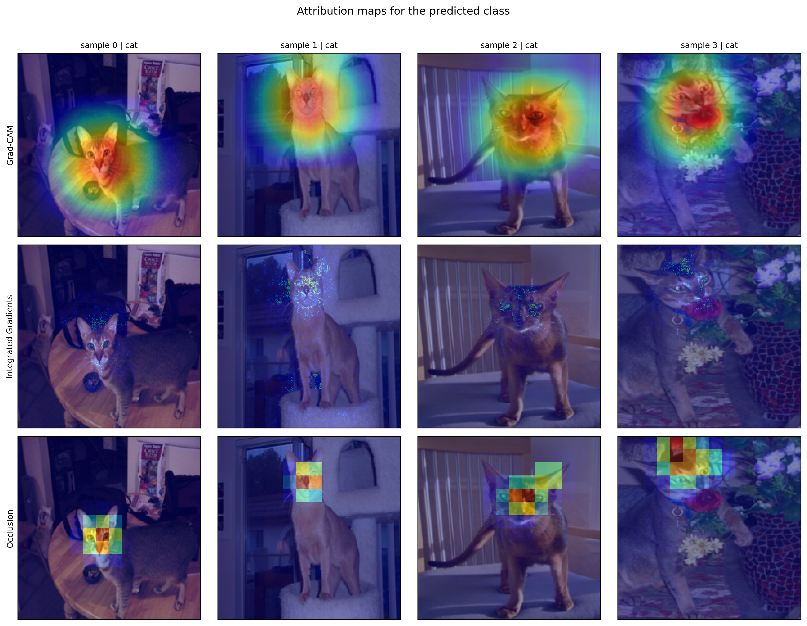
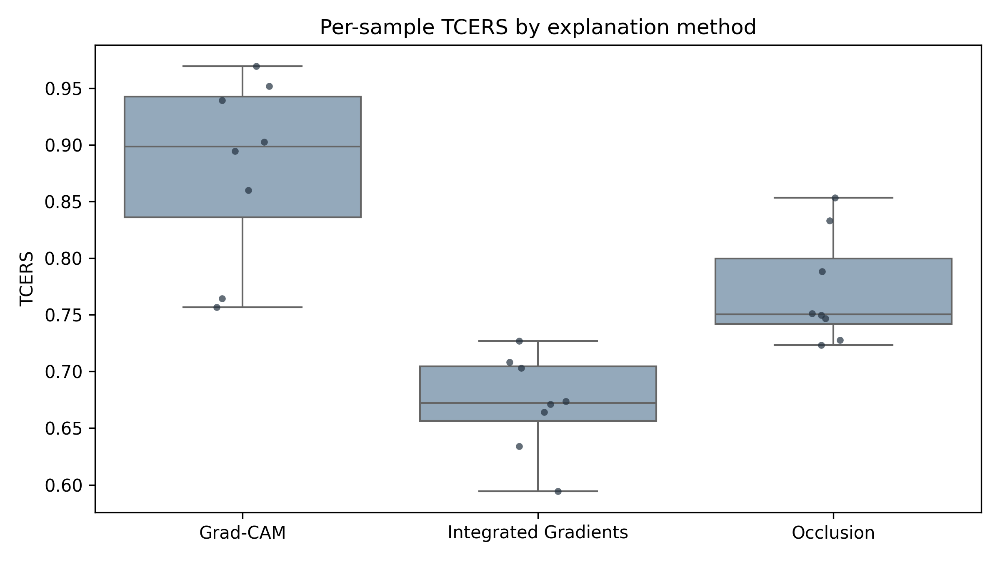
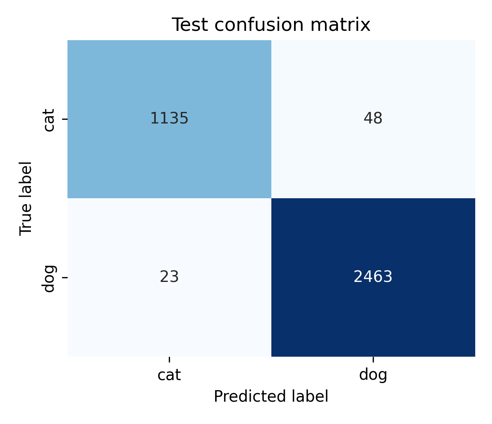

# Beyond Accuracy: XAI Reliability Under Input Perturbations

This repository implements a reproducible Master's-level study of explanation
stability for an ImageNet-pretrained ResNet18 on the Oxford-IIIT Pet Dataset
(binary cat-vs-dog classification).
It compares Grad-CAM, Integrated Gradients, and Occlusion Sensitivity under
small rotations, brightness changes, Gaussian noise, and resize perturbations.

**TCERS is a proposed evaluation score, not an established scientific metric.**
It averages SSIM, Spearman correlation, and cosine similarity only over
transformations for which the model prediction remains unchanged. Prediction
consistency and explanation stability are exported separately.

## Colab / local setup

```bash
pip install -r requirements.txt
python -m src.train --epochs 10
```

The dataset is downloaded automatically by `torchvision`. CUDA is detected
automatically; CPU execution is supported. In Colab, optionally mount Drive
and set `ExperimentConfig.data_root`, `output_root`, and `checkpoint_root` to
Drive paths before running.

## Execution order

1. `notebooks/01_data_exploration.ipynb`
2. `notebooks/02_model_training.ipynb`
3. `notebooks/03_explainability_methods.ipynb`
4. `notebooks/04_explanation_stability.ipynb`
5. `notebooks/05_proposed_method.ipynb`
6. `notebooks/06_statistical_analysis.ipynb`

The notebooks document the full experimental protocol, data diagnostics,
visualization, statistical analysis, and reporting guidance; reusable code lives
under `src/`. The figures and tables below were produced by the documented CPU
run (see `experiments/results/` and `figures/`); rerunning the notebooks
regenerates every artifact from scratch.

## Results preview

**Explanation maps.** Grad-CAM, Integrated Gradients, and Occlusion Sensitivity
computed for the same samples with the trained ResNet18. Grad-CAM produces the
most spatially coherent maps, while Integrated Gradients is visibly more
diffuse and Occlusion is blockier.



**Stability of explanations (TCERS).** Per-sample TCERS across 14
transformations (rotations, brightness, Gaussian noise, resizes), computed on
prediction-preserving pairs only. Mean TCERS: Grad-CAM 0.880 > Occlusion 0.772 >
Integrated Gradients 0.672, with all pairwise differences significant after Holm
correction (p = 0.023).



**Classification context.** The checkpoint used for all explanations reaches
98.07% test accuracy and 0.998 ROC-AUC, so stability results are not confounded
by a weak base model.



## Scientific safeguards

- Official `trainval` and `test` splits are used; validation is derived only
  from `trainval`.
- Fixed seeds, saved checkpoints, recorded configuration, and CSV export are
  used for reproducibility.
- TCERS excludes prediction-changing transformations and reports valid counts.
- Similarity metrics compare consistently normalized maps and reject mismatched
  shapes.
- Results must be reported with uncertainty and paired tests before claims of
  statistical significance.

## Literature foundation

Selvaraju et al. (2017), *Grad-CAM*; Sundararajan et al. (2017),
*Axiomatic Attribution for Deep Networks*; Petsiuk et al. (2018), *RISE*; and
Adebayo et al. (2018), *Sanity Checks for Saliency Maps*. Verify DOI, venue,
and year from the publisher before adding newer 2023--2026 references.

