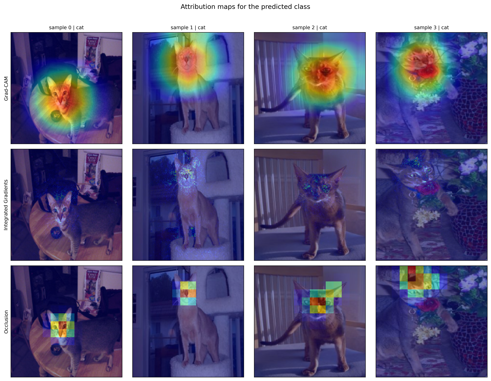
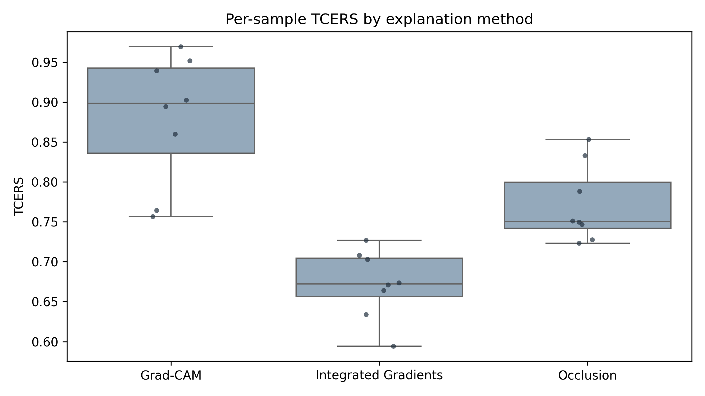

# Beyond Accuracy: XAI Reliability Under Input Perturbations

**Mini-projet — RNA et Deep Learning (2ème année Master SPI, 2026–2027)**
**Theme:** Projet 4 — Explainable AI (XAI)
**Team:** Aymen Ben Salem · Dheker Belil · Amen Allah Youssef

**Presentation (5 slides):** [`docs/presentation.pdf`](docs/presentation.pdf) ·
**Project report:** [`docs/report.pdf`](docs/report.pdf)

This repository studies whether post-hoc visual explanations stay stable when an
image is changed in small, meaning-preserving ways. We fine-tune an
ImageNet-pretrained ResNet18 on the Oxford-IIIT Pet dataset (binary cat vs dog),
explain its predictions with **Grad-CAM**, **Integrated Gradients** and
**Occlusion Sensitivity**, and measure how much each explanation changes under
rotation, brightness, Gaussian noise and resize perturbations.

> **TCERS is a proposed evaluation score, not an established metric.** It
> averages SSIM, Spearman correlation and cosine similarity only over
> transformations for which the model prediction is unchanged. Prediction
> consistency is always reported separately.

---

## 1. Problem and research questions

Saliency maps are used to justify model decisions, yet an explanation is only
useful if it describes the *same* decision consistently. If a 5° rotation leaves
the prediction unchanged but moves the heatmap from the animal's face to the
background, the explanation cannot be trusted. Earlier work showed explanations
can be made fragile on purpose (Ghorbani et al., 2019) and proposed sensitivity
measures (Yeh et al., 2019), but most stability evaluations (a) mix in
perturbations that change the prediction, (b) test a single perturbation
strength, and (c) report means without uncertainty.

- **RQ1.** Do Grad-CAM, Integrated Gradients and Occlusion differ in stability
  under mild, prediction-preserving perturbations?
- **RQ2.** How does stability change with perturbation family and strength
  (dose–response)?
- **RQ3.** Is the method ranking robust to the choice of similarity metric and
  weighting, and is it statistically supported?

## 2. Literature positioning

| Work | Contribution | Limitation we address |
|---|---|---|
| Ghorbani et al., AAAI 2019 | Adversarial perturbations change interpretations without changing the label | Adversarial, not natural, perturbations |
| Yeh et al., NeurIPS 2019 | Max-sensitivity / infidelity measures | Norm-ball noise only; no prediction filtering |
| Agarwal et al., ICLR-W 2022 | Relative stability (input / representation / output) | Tabular focus; no image-structure similarity |
| Daroya et al., ICCV-W 2023 (COSE) | Consistency vs sensitivity of saliency under augmentations; Grad-CAM scores best | Single strength per augmentation; no paired significance tests |
| Hedström et al., JMLR 2023 (Quantus) | Toolkit of 30+ XAI evaluation metrics incl. robustness | Evaluation tool, not a study protocol |
| Subramaniakuppusamy & Gajjar, arXiv 2026 (FASS) | Prediction-invariant stability benchmark (SSIM + Spearman + Jaccard); Grad-CAM > IG | Fixed magnitude per perturbation, no fine-tuning, equal weights, no significance tests (stated by the authors) |

Full references and links: [`papers/README.md`](papers/README.md).

## 3. Reproduced approach

We reproduce the **prediction-invariant stability protocol** (as in COSE and
FASS) with the three reference attribution methods:

- **Grad-CAM** (Selvaraju et al., 2017) on `layer4[-1]`, bilinear upsampling, min–max normalisation.
- **Integrated Gradients** (Sundararajan et al., 2017), zero baseline, 16 Riemann steps, |attribution| summed over channels.
- **Occlusion** (Zeiler & Fergus, 2014), 32×32 patch, stride 16.

**Data.** Oxford-IIIT Pet, official `trainval`/`test` splits; validation = 15 %
of `trainval` (seed 42). Train 3,128 / validation 552 / test 3,669 images;
≈ 32 % cats, 68 % dogs in every split. Images resized to 224×224 and normalised
with ImageNet statistics. See [`DATASET.md`](DATASET.md).

**Model.** ResNet18 (ImageNet weights), new 2-way head, AdamW (lr 3e-4,
wd 1e-4), ReduceLROnPlateau, early stopping (patience 3). Best epoch 3 of 6.

| Test metric | Value |
|---|---|
| Accuracy | 98.07 % |
| Precision / Recall (dog) | 98.09 % / 99.07 % |
| F1 | 98.58 % |
| ROC-AUC | 0.998 |

**Perturbations (14).** Rotation ±5/10/15°, brightness ×0.8/×1.2, Gaussian noise
σ = 0.01/0.03/0.05, resize 128/180/256 px (restored to 224).

**Comparison with published results (FASS, ImageNet, ResNet-50).** FASS
rescales Spearman to (ρ+1)/2; ours is rescaled the same way for this table.

| Method | SSIM — ours | SSIM — FASS | Spearman (rescaled) — ours | Spearman (rescaled) — FASS |
|---|---|---|---|---|
| Grad-CAM | 0.838 | 0.885 | 0.942 | 0.966 |
| Integrated Gradients | 0.721 | 0.706 | 0.804 | 0.603 |

The ranking Grad-CAM > Integrated Gradients is reproduced. Absolute values are
not directly comparable (different dataset, backbone, perturbation strengths,
and FASS mostly uses stronger single-magnitude perturbations, e.g. brightness ×1.5 and noise σ = 0.15).

## 4. Contribution: TCERS

For sample *x*, method *m* and the set **V(x)** of transformations that keep
the prediction unchanged:

```
TCERS(x, m) = mean over t in V(x) of
              w1·SSIM + w2·Spearman + w3·cosine   (default w = 1/3 each)
```

What it adds relative to FASS / COSE:

1. **Dose–response** — 14 perturbations across 4 families at several strengths instead of one fixed magnitude.
2. **Fine-tuned model** — prediction consistency stays at 92 % (103 of 112 pairs per method kept), versus 11.5–63.3 % retention across datasets in FASS, whose models were not fine-tuned.
3. **Occlusion** included as a perturbation-based method alongside gradient-based ones.
4. **Statistical rigour** — bootstrap 95 % CIs, paired Wilcoxon and t-tests, Cohen's d_z, Holm–Bonferroni correction.
5. **Weight sensitivity** — rankings recomputed under four weightings.

**Same-pairs comparison with the reference score.** On the same 336
prediction-preserving pairs, a FASS-style score (SSIM + Spearman rescaled to
(ρ+1)/2 + IoU of pixels above 0.5, our closest stored equivalent of FASS's top-k
Jaccard) gives the same ranking as TCERS — Grad-CAM 0.837 > Occlusion 0.734 >
IG 0.558 — and the per-image ranking agrees for 7 of 8 images. The conclusion
does not depend on the choice of score; the contribution is the protocol.

## 5. Results



| Method | Mean TCERS | 95 % CI | SSIM | Spearman | Cosine |
|---|---|---|---|---|---|
| Grad-CAM | **0.880** | [0.812, 0.948] | 0.838 | 0.883 | 0.939 |
| Occlusion | 0.772 | [0.731, 0.812] | 0.736 | 0.728 | 0.857 |
| Integrated Gradients | 0.672 | [0.636, 0.708] | 0.721 | 0.608 | 0.679 |

- **RQ1.** Grad-CAM > Occlusion > Integrated Gradients. All three paired
  differences are significant after Holm correction (Wilcoxon p = 0.023,
  Cohen's d_z between 1.55 and 1.89).
- **RQ2.** Gaussian noise barely affects any method (SSIM ≥ 0.85). Brightness
  is the hardest family (prediction consistency 69 %, IG SSIM 0.47), but see the
  clipping caveat in Limitations. Rotation
  and resize show clear dose–response: Grad-CAM SSIM drops from 0.89 at ±5° to
  ≈ 0.70 at ±15°; Occlusion drops from 0.81 at 256 px to 0.46 at 128 px.
- **RQ3.** The ranking is identical under equal, SSIM-heavy, Spearman-heavy
  and cosine-heavy weights.



## 6. Limitations

- **Small stability sample (8 test images, 336 explanation pairs).** With
  n = 8 the Wilcoxon p-value cannot go below 0.0078, so p = 0.023 after Holm is
  the smallest value attainable. Increase `NUM_SAMPLES` in Notebook 04 and rerun
  Notebooks 04–06 for stronger evidence.
- **Brightness is clipped.** `TF.adjust_brightness` clamps to [0, 1] but is
  applied to ImageNet-normalised tensors, so negative values are zeroed and the
  "×0.8 / ×1.2" perturbation is a strong distortion rather than a mild exposure
  change. Treat brightness results as a stress test. Fix: denormalise → adjust
  → renormalise in `src/perturbations/transforms.py`, then rerun Notebooks 04–06.
- Similarity is not stored for the 9 prediction-changing pairs per method, so an
  unconditioned baseline score cannot be computed from the exported tables.
- Stability is not faithfulness: a method can be consistently wrong. Sanity
  checks (Adebayo et al., 2018) and deletion/insertion tests are future work.
- One architecture, one dataset, four perturbation families.
- Integrated Gradients uses 16 steps, at the low end of what the original paper
  recommends, to keep runtime manageable on CPU.

## 7. Repository layout

```
src/                 reusable code (data, models, explainers, perturbations, metrics, evaluation)
notebooks/01–06      full protocol, executed with outputs
experiments/results/ every CSV / JSON produced by the run
figures/             every figure used in the report and slides
tests/               unit tests for the stability metrics
papers/              selected scientific articles (references and links)
docs/                presentation and report
DATASET.md           dataset description and how to obtain it
```

## 8. Reproduce

```bash
pip install -r requirements.txt
python -m src.train --epochs 10          # or run notebooks/02
pytest tests/
```

Then run the notebooks in order:
`01_data_exploration` → `02_model_training` → `03_explainability_methods` →
`04_explanation_stability` → `05_proposed_method` → `06_statistical_analysis`.

The dataset is downloaded automatically by `torchvision`. CUDA is used when
available; CPU is supported. In Colab, set `ExperimentConfig.data_root`,
`output_root` and `checkpoint_root` to Drive paths if you want persistence.

## 9. Deliverables (as required by the brief)

| Deliverable | Location |
|---|---|
| Presentation (≤ 5 slides) | `docs/presentation.pdf` |
| Project report | `docs/report.pdf` |
| Source code | `src/`, `notebooks/`, `tests/` |
| Selected scientific articles | `papers/README.md` |
| Selected dataset | `DATASET.md` |

## License

See [`LICENSE`](LICENSE).
